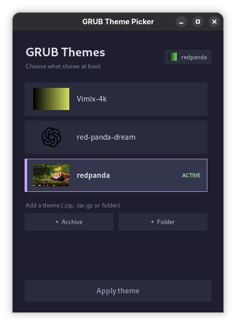
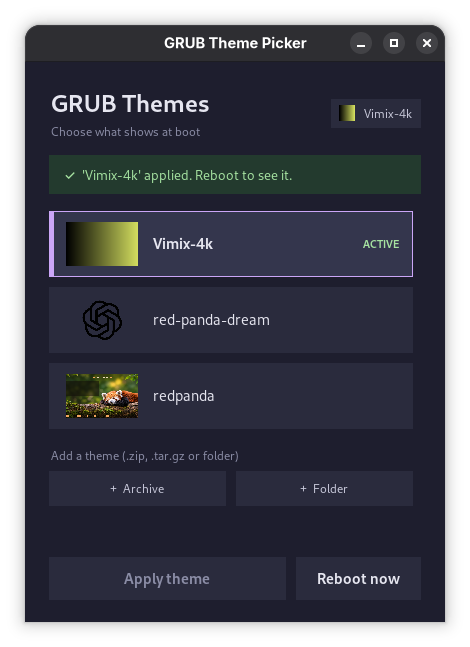

# GRUB Selector

A small desktop app for switching your GRUB boot theme: open it, pick a theme, apply, reboot.

[![Last Commit][last-commit-shield]][last-commit-url]
[![Repo Size][repo-size-shield]][repo-size-url]
[![Author][author-shield]][author-url]


# Index

1. [About the project](#about-the-project)
1. [Features](#features)
1. [Screenshots](#screenshots)
1. [Built with](#built-with)
1. [Getting started](#getting-started)
1. [How it works](#how-it-works)
1. [Contributing](#contributing)
1. [Authors](#authors)
1. [Acknowledgments](#acknowledgments)

# About the project

GRUB Selector is a simple GUI for people who keep several GRUB themes installed and want to switch between them without editing `/etc/default/grub` and regenerating the config by hand. It lists every theme in your GRUB themes folder, shows a preview of each one, and applies your choice with a single click. New themes can be added straight from a `.zip` / `.tar.gz` archive or a folder.

This repository contains **only the picker app**. It requires a GRUB bootloader. Themes live in the GRUB themes folder (`/boot/grub/themes` or `/boot/grub2/themes`), and you can add them from inside the app.

## Built with

![Python][tech-1-shield]
![Tkinter][tech-2-shield]
![GRUB][tech-3-shield]

## Features

- Lists every theme in your GRUB themes folder (any folder containing a `theme.txt`)
- Shows the current theme in the header and marks it as active in the list
- Preview swatch for each theme, so you can tell them apart at a glance
- Add new themes from a `.zip` / `.tar.gz` archive or a folder, right from the app
- Applies the theme and regenerates the GRUB config, asking for your password only when needed
- Clear feedback after applying, so you know whether it worked
- A **Reboot now** button that appears after a successful change
- Installs as a regular app, so you can find it by searching in your app launcher
- Works on Fedora, Debian, Ubuntu and Arch (detects `grub-mkconfig` / `grub2-mkconfig` automatically)

# Screenshots

| Theme picker | Applied theme |
|---|---|
|  |  |

# Getting started

## Prerequisites

- Python 3.8+ with Tkinter
- `pkexec` (polkit), used to ask for your password when applying or adding a theme
- GRUB (themes can be added from inside the app)
- Optional: [Pillow](https://python-pillow.org/), for image previews of JPG backgrounds (PNG works without it)

Installing Tkinter:

```sh
# Fedora
sudo dnf install python3-tkinter

# Debian / Ubuntu
sudo apt install python3-tk

# Arch
sudo pacman -S tk
```

## Installation

```sh
# Clone the repository
git clone https://github.com/erikpersson0884/grub-selector.git

# Navigate into the project directory
cd grub-selector

# Start the app
python3 app.py
```

Pick a theme in the list, click **Apply theme**, enter your password, then reboot.

## Adding themes

Use **+ Archive** (a `.zip` or `.tar.gz`) or **+ Folder** under the theme list. The app finds the theme inside it (it must contain a `theme.txt`), asks for your password, and copies it into the GRUB themes folder. It then shows up in the list, ready to apply. If a theme with the same name is already installed, you are asked before it is replaced.

## Install as an app

To get **GRUB Selector** in your app launcher, so you can search for it like any other app:

```sh
./install.sh
```

This installs it for your user only, into `~/.local`. Use `sudo ./install.sh` to install for everyone, and `./install.sh --uninstall` (with `sudo` if you installed that way) to remove it. If it doesn't show up right away, log out and back in.

## Command line

Everything the app does can also be done from the terminal:

```sh
sudo python3 app.py --apply <theme-folder-name>
sudo python3 app.py --install <archive-or-folder> [--replace]
```

# How it works

- **Theme discovery:** the app looks in `/boot/grub2/themes` or `/boot/grub/themes`, depending on which GRUB tools are installed, and lists every subfolder that contains a `theme.txt`.
- **Applying a theme:** it sets `GRUB_THEME` in `/etc/default/grub` to the chosen theme's `theme.txt`, makes sure `GRUB_TERMINAL_OUTPUT="gfxterm"` and `GRUB_TIMEOUT_STYLE="menu"` are set, and regenerates the config with `grub-mkconfig` or `grub2-mkconfig`.
- **Adding themes:** archives are extracted to a temporary folder (unsafe paths and symlinks are skipped), the folder containing `theme.txt` is copied to the themes folder, and the temporary files are removed. Adding a theme does not change your boot menu until you apply it.
- **Backup:** the first time it runs, your original file is saved as `/etc/default/grub.bak-themepicker`.
- **Permissions:** only applying and adding themes run as root (through `pkexec`). The window itself runs as your normal user.
- **Previews:** if a theme's `theme.txt` names a background image, the preview is a thumbnail of it. Otherwise it falls back to a gradient generated from the theme's name, so each theme always looks the same.
- **Left alone:** other settings such as `GRUB_GFXMODE` or `GRUB_DISABLE_OS_PROBER`, and any extra menu entries added by a theme's own installer, are not touched.

# Contributing

If you want to contribute, follow these steps:

1. Fork the repository
2. Create a new branch (`git checkout -b feature-branch`)
3. Make your changes and try them with `python3 app.py`
4. Commit your changes (`git commit -m 'Add new feature'`)
5. Push to the branch (`git push origin feature-branch`)
6. Create a Pull Request


# Authors

<p align="center">
  
  <br />
  <strong><a href="https://github.com/erikpersson0884">Erik Persson</a></strong><br />
  Creator &amp; Maintainer
</p>

# Acknowledgments

- [Cozy Red Panda GRUB theme](https://github.com/erikpersson0884) for the install flow this app is based on


<!-- Repo info shields -->
[last-commit-shield]: https://img.shields.io/github/last-commit/erikpersson0884/grub-selector/main?style=for-the-badge&cacheSeconds=30
[last-commit-url]: https://github.com/erikpersson0884/grub-selector/commits/main

[repo-size-shield]: https://img.shields.io/github/repo-size/erikpersson0884/grub-selector?style=for-the-badge&cacheSeconds=60
[repo-size-url]: https://github.com/erikpersson0884/grub-selector

[author-shield]: https://img.shields.io/badge/Author-Erik_Persson-purple?style=for-the-badge
[author-url]: https://github.com/erikpersson0884


<!-- Tech stack shields -->
[tech-1-shield]: https://img.shields.io/badge/Python-3776AB?logo=python&logoColor=white&style=for-the-badge
[tech-2-shield]: https://img.shields.io/badge/Tkinter-4B8BBE?logo=python&logoColor=white&style=for-the-badge
[tech-3-shield]: https://img.shields.io/badge/GRUB-5D5D5D?logo=gnu&logoColor=white&style=for-the-badge